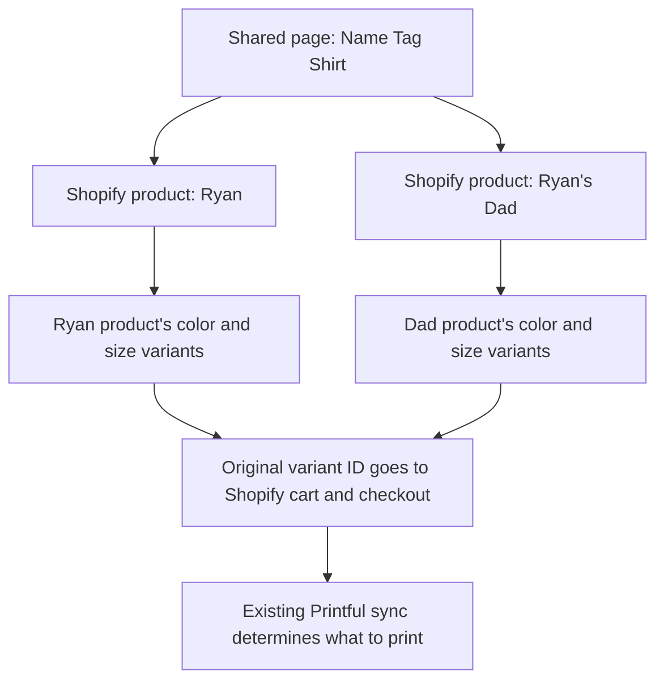

# Ryan Meetup Store

Headless Shopify storefront for `store.ryanmeetup.com`. Product and collection pages are rendered from the Shopify Storefront API, while checkout stays on Shopify. Judge.me supplies product reviews.

## Local development

From the repository root:

```sh
npm install
npm run dev:store
```

Copy `.env.example` to `.env.local` and add the development-store credentials. Without Shopify credentials, the app deliberately starts in a labeled preview mode with a small demo catalog and local cart; checkout and review submission remain disabled.

## Shopify setup

- Create public Storefront API access for products, collections, and carts.
- Set the headless storefront domain and checkout return URL to `https://store.ryanmeetup.com/thank-you`.
- Install/connect Printful in Shopify and map every Shopify variant to the matching Printful SKU.
- Customize checkout branding in Shopify Admin.
- Configure a catalog revalidation webhook before launch if five-minute ISR freshness is not sufficient.

## Storefront listings

For the Shopify-side steps when listing a new product, without the code
details, see [docs/ADDING_PRODUCTS.md](docs/ADDING_PRODUCTS.md).

The storefront can present several separate Shopify products as one **listing**:
one card and one product page with a **Style** selector for choosing a member.
Each product keeps its own variants, prices, images, description, reviews, and
Printful sync. Use a listing when customers think of the products as versions of
the same item: name tag designs, or the same print on two hoodie colors.

Listings are defined entirely by Shopify tags; no code change or deployment is
needed to create one. Shopify and Printful continue to manage the individual
products. The storefront reads Shopify's catalog and sends the selected product's
original variant ID to Shopify's cart and checkout.

### Listings, collections, types, tags, and titles

| Concept | What it controls | Example |
| --- | --- | --- |
| `listing:` tag | Products sharing it become one listing, titled by the text after `listing:`. | `listing:Name Tag Shirt` → `/products/name-tag-shirt` |
| Product Type | Which type page lists the product: `Apparel` appears on `/collections/apparel`, `Accessory` on `/collections/accessories`, and every product on `/collections/all`. | Every name tag shirt is `Apparel`. |
| Shopify collection | A manual collection of products, chosen in Shopify. Each one published to the storefront channel gets a home page section and a page at `/collections/<handle>`. | I Heart RY, Name Tag |
| Product title | The member's Style label: the title with the listing name removed. | `Ryan's Dad Name Tag shirt` in `listing:Name Tag Shirt` reads `Ryan’s Dad`. |
| Product handle | The member's URL identifier, normally also used in the `design` query parameter. | `ryans-dad-name-tag-shirt` |

**The tag controls inclusion; the title controls the label.** Putting "Name Tag"
in a product title alone does not add it to a listing, and neither does its Type.
The storefront ignores every tag other than `listing:`; they have no SEO effect.

Shopify copies a heart emoji from a title into the handle it generates, so
"I ❤️ RY" gets the handle `i-❤️-ry`. The storefront spells ❤️ and ♥ as `heart` in
every URL it builds — `/collections/i-heart-ry` — and redirects the emoji form
there. Titles keep the emoji. See [lib/handles.ts](lib/handles.ts).
Search metadata comes from product titles, descriptions, and images.

A collection can contain many listings and standalone products. A collection page
loads every product in the collection, replaces a listing's members with one
listing card, and loads the listing's other published members too, so the page
has no "Next page". A listing does not create a Shopify collection or add
products to one.

### Home page

The home page is built from Shopify collections, in this order:

1. The featured section shows up to eight listings from Shopify's built-in home
   page collection (handle `frontpage`, currently titled **Best Sellers**), in
   that collection's order and under its title and description. Keep it to
   hand-picked products. While it is empty or unpublished, the section shows the
   actual best sellers instead. This collection has no page or department card of
   its own.
2. Every other published collection gets a section with up to four listings and
   a link to its page. Sections are ordered by collection title, and listings by
   the collection's order in Shopify.
3. **More Ryan goods** lists every product that is in none of those collections,
   so a product never disappears from the home page. Add a product to a
   collection to move it out of this section.
4. **Choose your department** links to the three type pages.

### Type pages

`/collections/all`, `/collections/apparel`, and `/collections/accessories` are
defined in [lib/catalog-collections.ts](lib/catalog-collections.ts), not in
Shopify. Each one searches the catalog by the exact Product type (`Apparel` or
`Accessory`; *all* has no filter) and loads every match before grouping, so a
listing gets one card. A Shopify collection with
one of these handles is ignored in favor of the definition here.

### Example: name tag shirts

Products tagged `listing:Name Tag Shirt` share the listing `Name Tag Shirt` at
`/products/name-tag-shirt`. Separate products such as `Ryan Name Tag shirt` and
`Ryan's Dad Name Tag shirt` join it when tagged and published to the
storefront's sales channel.



Selecting `Ryan’s Dad`, then a color and size, identifies a variant of the Dad
product. Each member can offer different options and prices. Adding it to the
cart sends that variant's original Shopify ID and the requested quantity. The
cart and checkout use the underlying product's title and options. Printful uses
the existing sync for that variant, subject to the store's order-processing
settings. Adding a listing tag does not create or repair a Printful sync.

### Create a listing or add a product to one

This is a Shopify catalog task:

1. Create and sync the separate product through Printful and Shopify as usual.
   Ensure every variant offered for sale has the correct fulfillment mapping.
2. Title it so that removing the listing name leaves the member's label:
   `I Heart RY Hoodie - White` in `listing:I Heart RY Hoodie` reads `White`, and
   `Ryan's Dad Name Tag shirt` in `listing:Name Tag Shirt` reads `Ryan’s Dad`.
   Matching ignores capitalization, spaces, hyphens, and apostrophes. A title
   that does not contain the listing name is shown whole.
3. In Shopify **Products → the product → Product organization → Tags**, add
   `listing:` followed by the listing name, such as **`listing:I Heart RY
   Hoodie`**. Give a product only one `listing:` tag.
4. Set its Type to `Apparel` or `Accessory` so it appears on the matching type
   page, and add it to its Shopify collection.
5. Make the product active and publish it to the storefront's sales channel.
   The current channel is **Ryan Meetup Store Headless**.
6. Allow the catalog cache to refresh, then open the shared page and check the
   new member's label, photos, options, price, availability, and cart item.

The listing's URL is the listing name in lowercase with hyphens:
`listing:I Heart RY Hoodie` becomes `/products/i-heart-ry-hoodie`. Members may
vary the tag's capitalization or spacing and still share one listing; the first
member's spelling becomes the title. Members are ordered alphabetically by label,
and the first one is selected when the page opens. The listing card and page
description come from that first member. Renaming a listing changes its URL, so
existing links to the old name stop working.

Catalog requests use a five-minute revalidation interval, so changes normally
appear around the next refresh; the cache is not an immediate publishing signal.

Removing the listing tag restores a standalone product after refresh.
Unpublishing the product removes it from storefront discovery. A sold-out product
can remain published and visible as a sold-out member. If no published members
remain, the listing page returns 404.

Keep member Types consistent: the listing card inherits its Type and featured
image from the first member, while its minimum price and availability reflect
the whole listing. For unrelated products that customers should browse
individually, use a collection and keep their standalone pages.

### Photos, prices, reviews, and links

- The shared gallery combines every member's product and variant images,
  removing duplicate image URLs within each member. Selecting a photo selects
  its member and, when assigned to a variant, updates the variant selection.
  Floating previous/next buttons and Left/Right arrow keys cycle through the
  gallery and wrap at either end. Keyboard shortcuts apply while the gallery is
  visible and the page or gallery has focus; other controls keep their behavior.
  Thumbnails stay in a single horizontally scrolling row, with the selected
  photo kept in view. Each design's photos have a labelled border and photo
  count. Photos scroll inside each fixed frame, keeping its label and all four
  borders visible. On desktop,
  the gallery stays below the header while the
  product options and details scroll, and its image scales to fit shorter screens.
- The description's opening paragraph stays above the purchase options.
  Additional materials, sizing, disclaimers, and other supplied information
  remain available in **Product details** below the cart buttons. Shopify rich
  text and size tables are preserved; unfamiliar long HTML stays together in
  the disclosure rather than being split through its formatting.
- The selected member supplies its description, options, variant price,
  availability, and displayed reviews. Family cards show the minimum variant
  price and use **From** when prices differ. The family is available when any
  member is available; unavailable selections cannot be added to the cart.
- Member product URLs redirect to the shared page with `?design=...` selecting
  that member. Cart links reopen the matching design. This parameter identifies
  the member product; color and size are selected separately on the page.
- Listing metadata uses one canonical shared URL, and the sitemap lists the
  listing once. Catalog discovery follows Shopify pagination to find every published
  member; product detail requests also load every image and variant.
- Existing compatibility mappings keep `?design=ryan` and the listing's former
  `/products/nametag-shirt` URL working; `?design=ryans-mom` names the Mom
  shirt. These mappings, and Ryan as the default name tag design, are the only
  listing details kept in
  [lib/product-groups.ts](lib/product-groups.ts).

### Troubleshooting

| Symptom | Check |
| --- | --- |
| Product remains standalone | The product has a `listing:` tag with a name after the colon. A similar title or Type does not establish membership. |
| Product is missing from a listing | Active status, publication to the correct storefront channel, a `listing:` name that matches the others apart from capitalization and spacing, and cache refresh. |
| Listing is missing from a collection | On a type page, at least one member has that exact Type. On a Shopify collection, at least one member belongs to it. Listing membership alone does not add a listing to every collection. |
| Style label is unexpected | The product title should contain the listing name; the label is whatever remains. Identical remainders produce identical labels. |
| Type filter or card category is unexpected | Member Types should match; the listing inherits its Type from the first member. |
| Cart item or fulfillment is wrong | Confirm the selected underlying product and variant, then its Shopify/Printful sync. The listing tag only controls presentation. |
| Preview differs from the live catalog | Without Shopify credentials, the app uses [lib/demo-data.ts](lib/demo-data.ts). Demo entries do not establish what is published in Shopify. |

## Judge.me setup

Install Judge.me in the same Shopify store and provide its private API token server-side. Published reviews are read during product-page rendering; new reviews post through the server route and follow Judge.me moderation settings.
