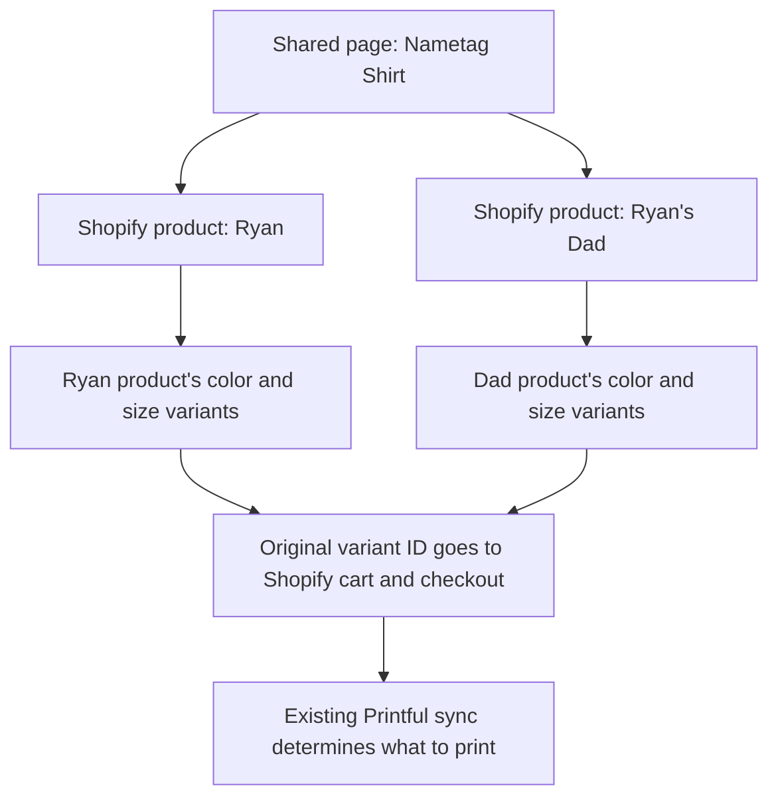

# Ryan Meetup Store

Headless Shopify storefront for `store.ryanmeetup.com`. Product and collection pages are rendered from the Shopify Storefront API, while checkout stays on Shopify. Judge.me supplies product reviews.

## Local development

From the repository root:

```sh
npm install
npm run dev:store
```

Copy `.env.example` to `.env.local` and add the development-store credentials. Without Shopify credentials, the app deliberately starts in a labeled preview mode with a small demo catalog and local cart; checkout and review submission remain disabled.

## Shopify setup

- Create public Storefront API access for products, collections, and carts.
- Set the headless storefront domain and checkout return URL to `https://store.ryanmeetup.com/thank-you`.
- Install/connect Printful in Shopify and map every Shopify variant to the matching Printful SKU.
- Customize checkout branding in Shopify Admin.
- Configure a catalog revalidation webhook before launch if five-minute ISR freshness is not sufficient.

## Storefront product groups

The storefront can present several separate Shopify products as one product
family, with a shared listing and a selector for choosing a member. Each product
keeps its own variants, prices, images, description, reviews, and Printful sync.
This works well when customers think of the products as different designs of the
same item: nametag shirts, city mugs, illustrated posters, or embroidered hats.

The grouping lives in this app. Shopify and Printful continue to manage the
individual products. The storefront reads Shopify's catalog and sends the
selected product's original variant ID to Shopify's cart and checkout.

### Collections, groups, types, tags, and titles

| Concept | What it controls | Nametag example |
| --- | --- | --- |
| Shopify collection | A browsing page containing products, such as apparel or accessories. | A shirt belongs to an apparel collection. |
| Storefront product group | One shared product listing and detail page for a family of products. Defined in this app's code. | `/products/nametag-shirt` |
| Product tag | Membership in a configured group. Products can have multiple tags. | The exact tag `name tag` joins the nametag group. |
| Product Type | One custom classification used for the storefront's type filter and small category labels. | `T-shirts` |
| Product title | The source of the member's label in the design selector. | `Ryan's Dad Name Tag shirt` becomes `Ryan’s Dad`. |
| Product handle | The member's URL identifier, normally also used in the `design` query parameter. | `ryans-dad-name-tag-shirt` |

**The tag controls inclusion; the title controls the design label.** Putting
"Name Tag" in a product title alone does not add it to the group. Setting its Type
to `T-shirts` does not add it either. Other tags can remain on the product.

Product tags support organization, collections, and Shopify's store search;
they are separate from SEO metadata. Adding keywords to product tags does not
directly improve Google rankings. See Shopify's documentation on
[tags](https://help.shopify.com/en/manual/products/details/tags) and
[product types](https://help.shopify.com/en/manual/products/details/product-type).
Shopify's standardized **Category** is another field, used for taxonomy, tax,
and sales-channel compatibility; this app does not use it to determine group
membership.

A collection can contain many product families and standalone products. When
the storefront encounters a group member in a collection's results, it replaces
the members in that result page with one family card and loads the family's other
published members too. A group does not automatically create a Shopify
collection or add products to one; manage collection membership in Shopify.

### Example: nametag shirts

The group configured in [lib/product-groups.ts](lib/product-groups.ts) has the
title `Nametag Shirt`, handle `nametag-shirt`, and membership tag `name tag`.
Separate products such as `Ryan Name Tag shirt` and `Ryan's Dad Name Tag shirt`
join it when tagged and published to the storefront's sales channel.



Selecting `Ryan’s Dad`, then a color and size, identifies a variant of the Dad
product. Each member can offer different options and prices. Adding it to the
cart sends that variant's original Shopify ID and the requested quantity. The
cart and checkout use the underlying product's title and options. Printful uses
the existing sync for that variant, subject to the store's order-processing
settings. Adding the grouping tag does not create or repair a Printful sync.

### Add a product to an existing group

Once the group's storefront code is deployed, this is a Shopify catalog task:

1. Create and sync the separate product through Printful and Shopify as usual.
   Ensure every variant offered for sale has the correct fulfillment mapping.
2. Give it a descriptive title so customers can identify the member.
3. In Shopify **Products → the product → Product organization → Tags**, add the
   configured membership tag and save. For nametag shirts, use the single tag
   **`name tag`**, including the space. Keep other useful tags.
4. Set a consistent Type for the family if it should appear under the same type
   filter, and add the product to the intended Shopify collections.
5. Make the product active and publish it to the storefront's sales channel.
   The current channel is **Ryan Meetup Store Headless**.
6. Allow the catalog cache to refresh, then open the shared page and check the
   new member's label, photos, options, price, availability, and cart item.

Catalog requests use a five-minute revalidation interval, so changes normally
appear around the next refresh; the cache is not an immediate publishing signal.
Later members of an existing group need no code change or redeployment.

Removing the membership tag restores a standalone listing after refresh.
Unpublishing the product removes it from storefront discovery. A sold-out product
can remain published and visible as a sold-out design. If no published members
remain, the group page returns 404.

### Create a new group

A new group needs a code definition and deployment before its tag has grouping
behavior. An arbitrary tag by itself does not create a shared page.

Add an entry to the `productGroups` array in
[lib/product-groups.ts](lib/product-groups.ts). For example, a city mug family
could use:

```ts
{
  handle: "city-mug",
  title: "City Mug",
  description: "Choose a city design for your mug.",
  tag: "group-city-mug",
  defaultDesign: "boston-city-mug",
  legacyDesignValues: {},
  legacyProductHandles: {},
}
```

This is an illustrative configuration, not an existing catalog group.

| Setting | Meaning |
| --- | --- |
| `handle` | Shared page slug: `/products/city-mug`. Use a unique, stable value that does not conflict with another group or product route. |
| `title` | Shared listing and page heading. |
| `description` | Group metadata and structured-data description. The visible detail description comes from the selected member. |
| `tag` | Shopify tag that identifies members. The `group-` prefix in this example is a naming convention, not special syntax. |
| `defaultDesign` | Optional selector value to show first. Usually a product handle; use a legacy value when configured. Remaining members sort alphabetically by their derived labels. |
| `legacyDesignValues` | Product handles mapped to older selector values, preserving existing links. Use `{}` for a new group. |
| `legacyProductHandles` | Old product handles mapped to their current handles. Use `{}` for a new group. |

Then adapt the presentation for the new family, validate it, deploy, and tag and
publish its members using the steps above. For this example, products with the
tag `group-city-mug` would share `/products/city-mug`, and a member link would be
`/products/city-mug?design=boston-city-mug`.

The catalog grouping and purchase flow already support multiple group
definitions. Two presentation details currently need attention when reusing the
system outside nametag shirts:

- [components/product-group-detail.tsx](components/product-group-detail.tsx)
  currently labels the selector **Nametag design**. Make this generic or
  configurable when introducing another family.
- `getProductDesign` in [lib/product-groups.ts](lib/product-groups.ts) currently
  removes "name tag", "shirt", "t-shirt", and "tee" wording from titles. It does
  not remove arbitrary group titles or words such as "mug" or "poster". Choose
  suitable product titles or adapt the label derivation for the new family.

Give each group its own membership tag, and assign each product to one group.
The current lookup chooses the first matching group if a product has more than
one group's tag. Keep member Types consistent: the family card inherits its
Type and featured image from the first member, while its minimum price and
availability reflect the group. For unrelated products that customers should
browse individually, use a Shopify collection and keep their standalone pages.

### Photos, prices, reviews, and links

- The shared gallery combines every member's product and variant images,
  removing duplicate image URLs within each member. Selecting a photo selects
  its member and, when assigned to a variant, updates the variant selection.
  Floating previous/next buttons and Left/Right arrow keys cycle through the
  gallery and wrap at either end. Keyboard shortcuts apply while the gallery is
  visible and the page or gallery has focus; other controls keep their behavior.
  Thumbnails stay in a single horizontally scrolling row, with the selected
  photo kept in view. Each design's photos have a labelled border and photo
  count. Photos scroll inside each fixed frame, keeping its label and all four
  borders visible. On desktop,
  the gallery stays below the header while the
  product options and details scroll, and its image scales to fit shorter screens.
- The description's opening paragraph stays above the purchase options.
  Additional materials, sizing, disclaimers, and other supplied information
  remain available in **Product details** below the cart buttons. Shopify rich
  text and size tables are preserved; unfamiliar long HTML stays together in
  the disclosure rather than being split through its formatting.
- The selected member supplies its description, options, variant price,
  availability, and displayed reviews. Family cards show the minimum variant
  price and use **From** when prices differ. The family is available when any
  member is available; unavailable selections cannot be added to the cart.
- Member product URLs redirect to the shared page with `?design=...` selecting
  that member. Cart links reopen the matching design. This parameter identifies
  the member product; color and size are selected separately on the page.
- Group metadata uses one canonical shared URL, and the sitemap lists the group
  once. Catalog discovery follows Shopify pagination to find every published
  member; product detail requests also load every image and variant.
- Existing compatibility mappings keep `?design=ryan` working. The Dad shirt was
  previously mislabeled as Mom; `/products/ryans-mom-name-tag-shirt` and
  `?design=ryans-mom` resolve to the corrected Dad design. These mappings preserve
  links; new group members are discovered through tags.

### Troubleshooting

| Symptom | Check |
| --- | --- |
| Product remains a standalone listing | The group definition is deployed and the product has its configured membership tag. A similar title or Type does not establish membership. |
| Product is missing from the group | Active status, publication to the correct storefront channel, exact membership tag, and cache refresh. |
| Family is missing from a collection | At least one member belongs to that Shopify collection and is present in the requested result page. Group membership alone does not add a family to every collection. |
| Selector label is unexpected | The Shopify product title and `getProductDesign` title cleanup. The tag is not the display label. |
| Type filter or card category is unexpected | Member Types should match; the group inherits its Type from the first member. |
| Cart item or fulfillment is wrong | Confirm the selected underlying product and variant, then its Shopify/Printful sync. The grouping tag only controls presentation. |
| Preview differs from the live catalog | Without Shopify credentials, the app uses [lib/demo-data.ts](lib/demo-data.ts). Demo entries do not establish what is published in Shopify. |

## Judge.me setup

Install Judge.me in the same Shopify store and provide its private API token server-side. Published reviews are read during product-page rendering; new reviews post through the server route and follow Judge.me moderation settings.
